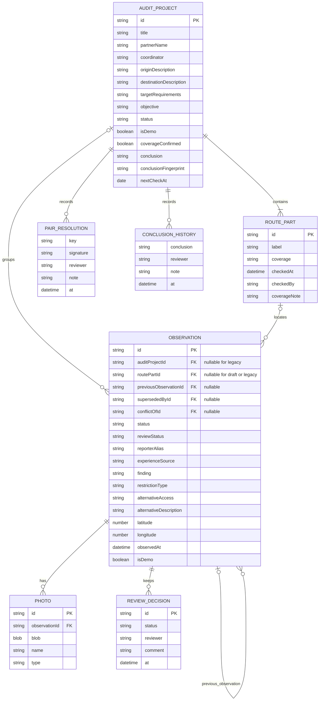

# ERD текущего пилота

Это логическая схема локального хранилища, не схема SQL/PostGIS. Вложенные массивы показаны отдельными сущностями для объяснения связей.

IndexedDB `urban-accessibility-field-v1`, версия 2. Название базы оставлено прежним для миграции. Физические object stores: projects, observations, photos. Route Part, Pair Resolution и Conclusion History вложены в проект, Review Decision — в наблюдение.

В базе нет FK-ограничений: принадлежность проверяют функции приложения и импорт. Импорт сначала строит полный проверенный план, затем записывает его одной транзакцией. Фото принадлежат одному наблюдению; ID фотографии включает ID наблюдения, чтобы участники не перезаписывали чужие фото.

История готовых записей не удаляется через интерфейс. Можно удалить черновик вместе с его фото. Версия базы 1 обновляется добавлением projects, без очистки старых stores; обратное открытие старым приложением не поддерживается. Для восстановления служат JSON-копии.

[Прежняя SQL-модель Barrier / Accessibility Impact / графа](archive/06-erd.md) — архив, не реализованная БД приложения.
